<div align="center">

  <!-- Header Banner -->
  <a href="https://github.com/Nidhex">
    
  </a>

  <!-- Animated Typing Tagline -->
  <a href="https://readme-typing-svg.demolab.com">
    
  </a>

  <br/>

  <!-- Profile Quick Badges -->
  <p align="center">
    
    
    
  </p>

</div>

---

### 🔮 System Diagnostics & About Me

<table>
  <tr>
    <td width="55%" valign="top">
      <pre>
<b><span style="color: #00F0FF;">nidhex@github-mainframe</span>:<span style="color: #8A2BE2;">~</span>$</b> neofetch --dev-mode
<span style="color: #00F0FF;">──────────────────────────────────────────────</span>
  <b>👤 Identity</b>      : Nidhish Vaishnav
  <b>🎓 Academics</b>     : Computer Science & Engg. (CSE '29)
  <b>☕ Fuel Level</b>    : 99.8% Roasted Coffee
  <b>🎯 Current Quest</b> : Crushing Java DSA & Advanced Backend
  <b>🌱 In the Loop</b>   : <code>Learn ➔ Build ➔ Break ➔ Rebuild</code>
  <b>⚔️ Weaponry</b>      : Java, C++, JavaScript, React, Node.js
  <b>⚡ Philosophy</b>    : "Make it work, make it right, make it fast."
<span style="color: #00F0FF;">──────────────────────────────────────────────</span>
<b><span style="color: #00F0FF;">nidhex@github-mainframe</span>:<span style="color: #8A2BE2;">~</span>$</b> <span style="animation: blink 1s infinite;">█</span></pre>
    </td>
    <td width="45%" align="center" valign="middle">
      
    </td>
  </tr>
</table>

---

### ⚔️ Tech Arsenal & Stack

<div align="center">

  <p><b>⚡ Core Languages & Systems</b></p>
  <a href="https://skillicons.dev">
    
  </a>
  <br/><br/>

  <p><b>🌐 Frontend Alchemy</b></p>
  <a href="https://skillicons.dev">
    
  </a>
  <br/><br/>

  <p><b>⚙️ Backend Engines & Databases</b></p>
  <a href="https://skillicons.dev">
    
  </a>
  <br/><br/>

  <p><b>🛠️ Dev Tools & Environments</b></p>
  <a href="https://skillicons.dev">
    
  </a>

</div>

---

### 🕹️ Mission Control & Contribution Arcade

<div align="center">
  <p><b>👾 PACMAN DEVOURING COMMITS</b></p>
  <picture>
    <source media="(prefers-color-scheme: dark)" srcset="https://raw.githubusercontent.com/Nidhex/Nidhex/pacman-output/pacman-contribution-graph-dark.svg?game=pacman">
    <source media="(prefers-color-scheme: light)" srcset="https://raw.githubusercontent.com/Nidhex/Nidhex/pacman-output/pacman-contribution-graph.svg?game=pacman">
    
  </picture>
</div>

<br/>

<div align="center">
  <!-- GitHub Streak Card -->
  <a href="https://github.com/Nidhex">
    
  </a>
  <br/><br/>

  <!-- Stats & Languages Output from Nidhex Workflows -->
  
  &nbsp;
  
</div>

---

### 🎧 The Coding Sanctuary

<div align="center">
  <br/>
  
</div>

---

### 🚀 Let's Connect & Build Together

<div align="center">

  <a href="https://www.linkedin.com/in/nidhish-vaishnav-0aa288386/" target="_blank">
    
  </a>
  &nbsp;
  <a href="https://x.com/nidhex" target="_blank">
    
  </a>
  &nbsp;
  <a href="https://t.me/Nidsss1003" target="_blank">
    
  </a>
  &nbsp;
  <a href="mailto:nidsvaishnav10@gmail.com" target="_blank">
    
  </a>
  &nbsp;
  <a href="https://www.instagram.com/nidhish_vshn07?igsi=MWptdnlybmxjZXdpaQ==" target="_blank">
    
  </a>

</div>

---

### 👾 Secret Terminal Access

<details>
  <summary><b>⚡ [CLICK TO INITIALIZE DEVELOPER EASTER EGG] 🔓</b></summary>
  <br/>

```text
       ___  _   __  ____  __  __ _______  __
      / _ \/ | / / /  _/ / / / // ____/ |/ /
     / // /  |/ /  / /  / /_/ // __/  |   / 
    / // / /|  / _/ /  / __  // /___ /   |  
   /____/_/ |_/ /___/ /_/ /_//_____//_/|_|  
                                            
   >>> SYSTEM STATUS: OPERATIONAL
   >>> CAFFEINE LEVEL: OPTIMAL
   >>> BUGS SQUASHED: 404 (BUG NOT FOUND)
   >>> MISSION: MASTER DISTRIBUTED SYSTEMS & ARCHITECT THE FUTURE
```

> *"There are only two hard things in Computer Science: cache invalidation, naming things, and off-by-one errors."*

</details>

---

<!-- Bottom Animated Wave -->
<div align="center">
  
  <p align="center">
    <sub>Crafted with 💜, ☕, and an unhealthy amount of debugging by <b>Nidhish Vaishnav</b></sub>
  </p>
</div>
